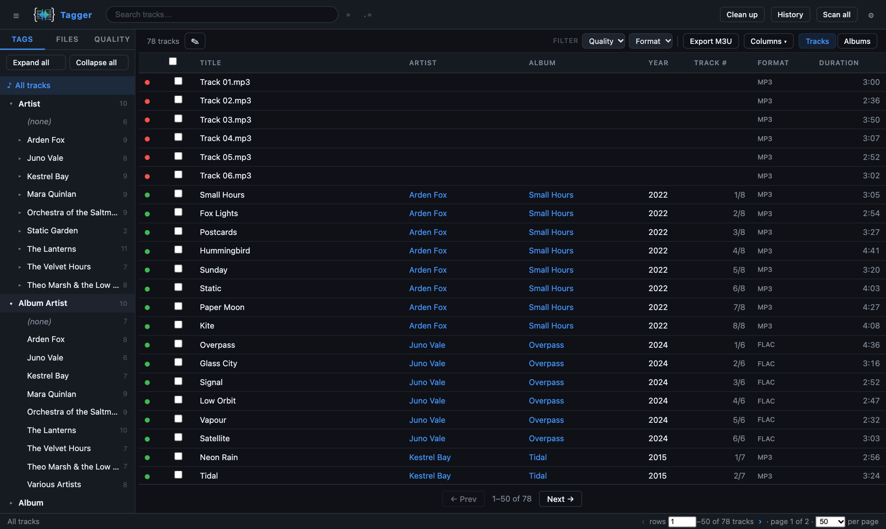
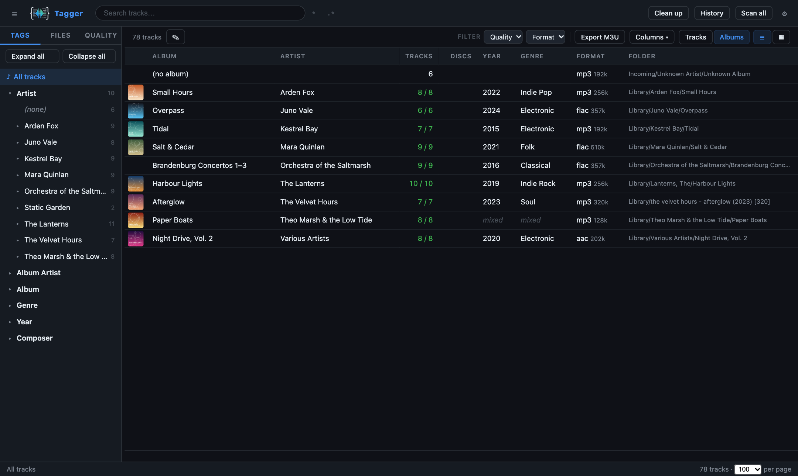
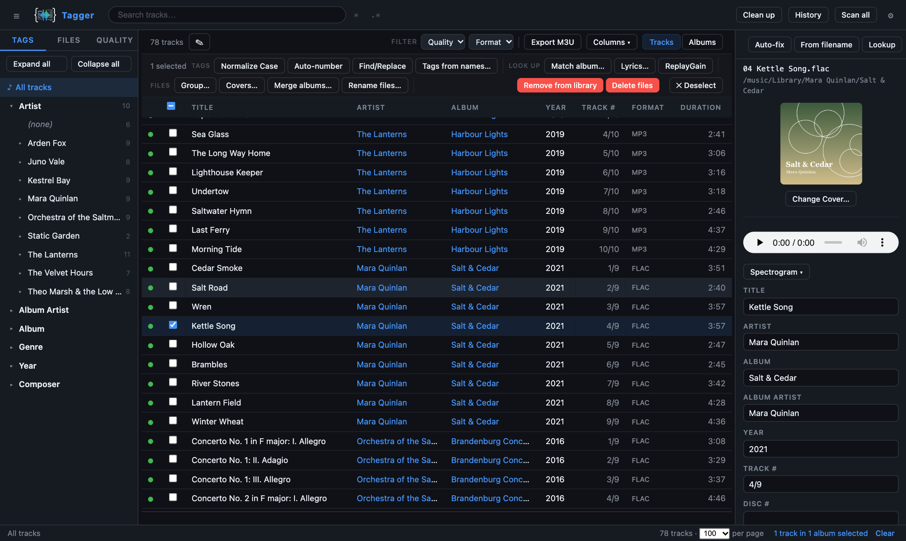
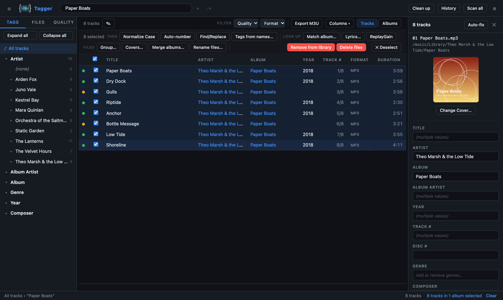
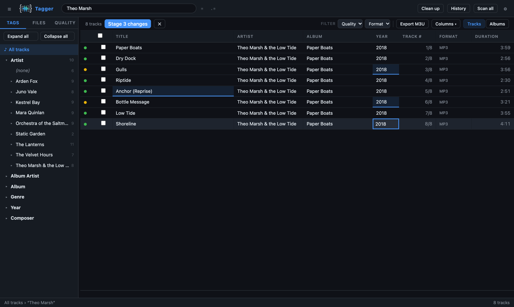
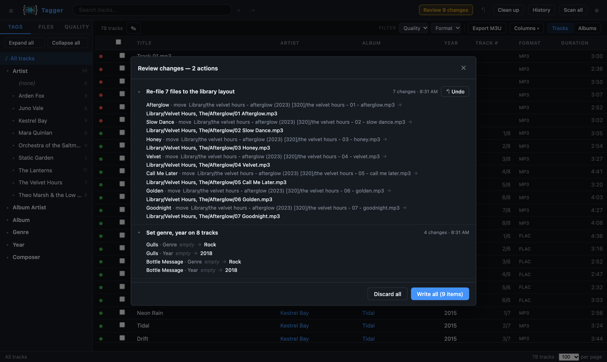
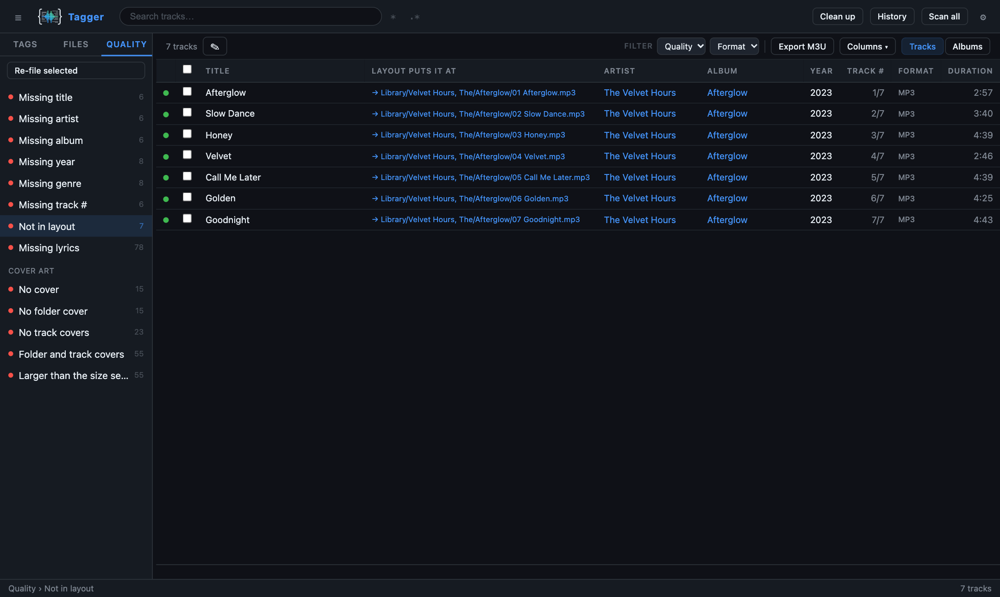
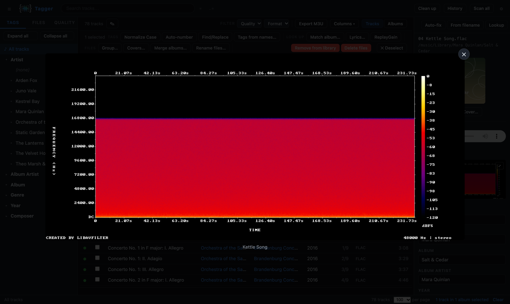

```
   __
  / /_____ _____ _____ ____  _____
 / __/ __ `/ __ `/ __ `/ _ \/ ___/
/ /_/ /_/ / /_/ / /_/ /  __/ /
\__/\__,_/\__, /\__, /\___/_/
         /____//____/
```

Self-hosted web app for editing audio tags (FLAC, MP3, AAC/M4A, OGG) — run it
on a NAS or server and tag your library from any browser.

Forked from [rnhinson/tagger](https://github.com/rnhinson/tagger) (MIT) and developed separately since 2026-09.

[](https://github.com/beartums/tagger/actions/workflows/ci.yml)
[](https://github.com/beartums/tagger/actions/workflows/publish.yml)
[](LICENSE)

## Quick start

### Docker Compose

Save this as `docker-compose.yml`, set your music path, and run `docker compose up -d`:

```yaml
services:
  tagger:
    image: ghcr.io/beartums/tagger:latest
    container_name: tagger
    restart: unless-stopped
    ports:
      - "8000:8000"
    volumes:
      - /your/music:/music       # ← your library (read/write)
      - tagger-config:/config    # library.db + settings.json
    # environment:
    #   - TAGGER_PASSWORD=change-me

volumes:
  tagger-config:
```

→ http://localhost:8000

### Docker CLI

```bash
docker run -d -p 8000:8000 \
  -v /your/music:/music \
  -v tagger-config:/config \
  ghcr.io/beartums/tagger:latest
# → http://localhost:8000
```

Multi-arch images (`amd64` + `arm64`) are published to GHCR: `latest` and
`main-<sha>` on every push to main, `X.Y.Z` and `X.Y` for each release.
See the [self-hosting guide](docs/SELF-HOSTING.md) for HTTPS, reverse-proxy,
health-check, and backup notes.

## Screenshots

| Track list | Albums |
|:---:|:---:|
|  |  |
| **Tag editor** | **Bulk editing** |
|  |  |
| **Edit mode** | **Review before writing** |
|  |  |
| **Not in layout** | **Spectrogram** |
|  |  |

The screenshots use a made-up demo library. The spectrogram is a track tagged
FLAC that was really re-encoded from a 128 kbps MP3: the hard shelf at ~16 kHz
gives it away, even though its format and bitrate say lossless.

## Features

- **Libraries** — scan one or more music folders into a SQLite index (exclude
  globs, optional auto-rescan). Browse by tag tree (artist → album, album
  artist, genre, year, composer), folder, album grid or quality issue. Search
  as full text, glob or regex over the fields you choose. Page through big
  views with rows per page and a jump-to row.
- **Bulk tagging** — every common tag (composer, BPM, lyrics, compilation…)
  on one track or thousands. The editor shows the values a selection shares
  and saves only the fields you change. Select across pages with ⌘/Ctrl-click,
  Shift-click ranges or *Select all N in this view*. Also: a spreadsheet-style
  edit mode in the table, find & replace (plain or regex, previewed),
  auto-number and case normalization.
- **Review before writing** — edits, lookups, moves and renames are staged
  first. **Review** shows a field-by-field diff and the planned moves, then
  writes everything in the background as one undoable change, or discards it.
  **History** undoes any past change.
- **Templated file structure** — each library (or group of tracks) has a
  layout such as `{album_artist_the}/{album_the}/{track_number:02d} {title}`.
  *Not in layout* lists tracks that aren't where their layout puts them, and
  re-files the ones you pick. **Rename files…** does PowerRename-style renames
  (regex, captures, counters). Folders move or rename from the Files tree,
  with drag and drop. Moves stay inside their library, never overwrite, and
  undo across filesystems.
- **Metadata lookup** — MusicBrainz album matching with an edition picker,
  *Match albums* for many albums at once, AcoustID fingerprints and Discogs.
  **Auto-fix** proposes album, album artist, year, numbers, genre and composer
  per track, and you can drop any track or field, or pick another match.
  Tags can also be inferred from file names.
- **Cover art** — from disk, the Cover Art Archive, a MusicBrainz search or a
  URL, written to the folder, the tracks or both and resized to your settings.
  Find covers for many albums at once; **Covers…** moves, copies, shrinks or
  deletes them.
- **Lyrics** — synced or plain from LRCLIB, looked up in the background for a
  whole library. Query templates per group handle cast albums and
  soundtracks, and you can search by hand.
- **Quality** — views for missing tags, lyrics, covers and files, oversized
  covers, tracks not in layout, and duplicate tracks (tags + length, or audio
  fingerprint) and albums, with a review that keeps the best copy.
  Bitrate/sample-rate columns and a per-file **spectrogram** expose lossy
  transcodes.
- **Files & playback** — `.m3u` export, ReplayGain, a recoverable trash, and
  seekable audio in the tag editor.
- **Ops** — optional rate-limited password login, API keys encrypted at rest,
  `/api/health`, a responsive UI and keyboard shortcuts (press `?`).

## Configuration

| Variable            | Default    | Description                              |
|---------------------|------------|------------------------------------------|
| `TAGGER_MUSIC_DIR`  | `/music`   | Root of your music library               |
| `TAGGER_CONFIG_DIR` | `/config`  | Where `library.db` + `settings.json` live |
| `TAGGER_LIBRARY_ROOTS` | *(music dirs)* | Colon-separated library folders that layouts are relative to; globs allowed (`/music/Shared:/music/Libraries/*`). Overridden by Settings |
| `TAGGER_PASSWORD`   | *(unset)*  | If set, requires a login                 |
| `TAGGER_SECURE_COOKIE` | *(unset)* | Mark the session cookie `Secure` (HTTPS) |
| `TAGGER_SECRET_KEY` | *(unset)*  | Fernet key that encrypts API keys in `settings.json`; without it they're stored as plain text |
| `ACOUSTID_API_KEY`  | *(unset)*  | Enables AcoustID fingerprint lookup      |
| `TAGGER_LOG_LEVEL`  | `INFO`     | Log verbosity                            |

The AcoustID key, a Discogs token and an LRCLIB app key can also be set in
**Settings → Sources**, each with a **Test** button. Generate a secret key with
`python -c "from cryptography.fernet import Fernet; print(Fernet.generate_key().decode())"`
and keep it outside the config volume, so a copy of `settings.json` alone
doesn't reveal the keys.

Auth is off unless `TAGGER_PASSWORD` is set. ReplayGain uses `rsgain` (bundled
in the image) or `loudgain` when present, and spectrograms need `ffmpeg` (also
bundled); each feature hides itself when its tool is missing. Full details,
including HTTPS setup, are in the [self-hosting guide](docs/SELF-HOSTING.md).

## Development

Requires Python 3.12+ and Node 20+.

```bash
export TAGGER_MUSIC_DIR=~/Music   # optional
./dev.sh                          # backend :8000 + Vite dev server :5173
```

Run the checks CI runs: `cd backend && pytest`, and
`cd frontend && npx tsc --noEmit && npm run build`. See
[CONTRIBUTING.md](CONTRIBUTING.md) for project layout and conventions.

## License

[MIT](LICENSE).
